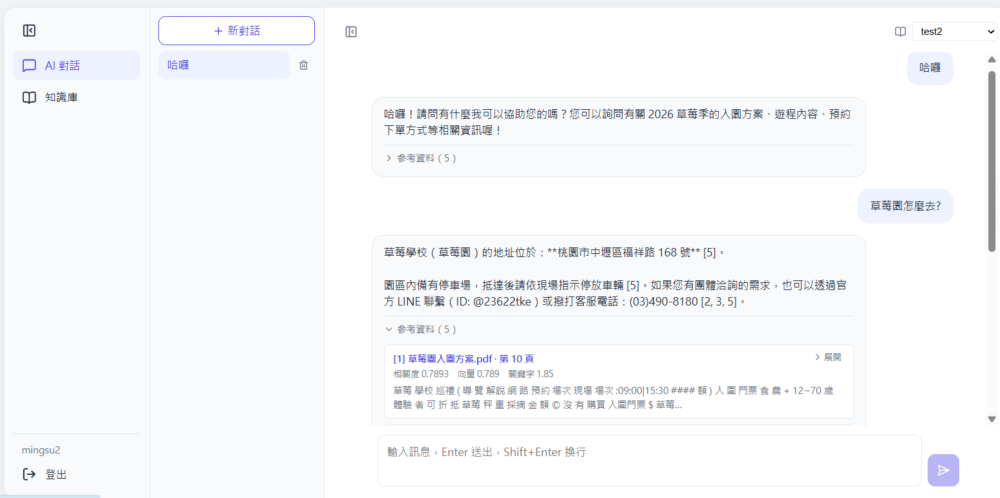
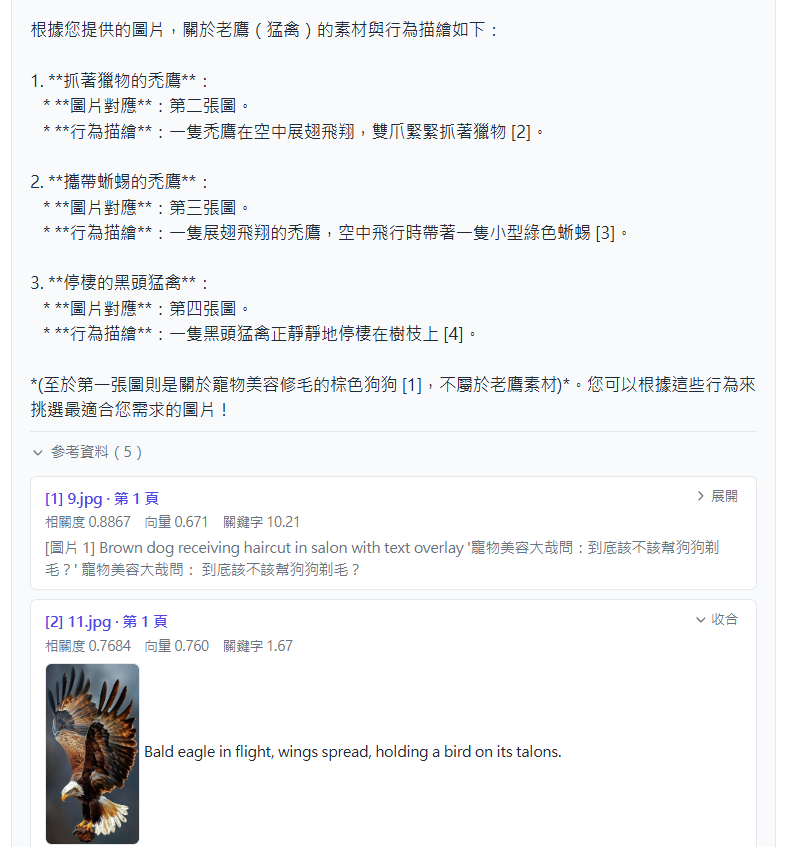
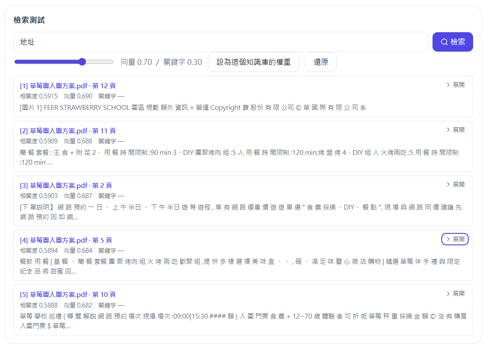
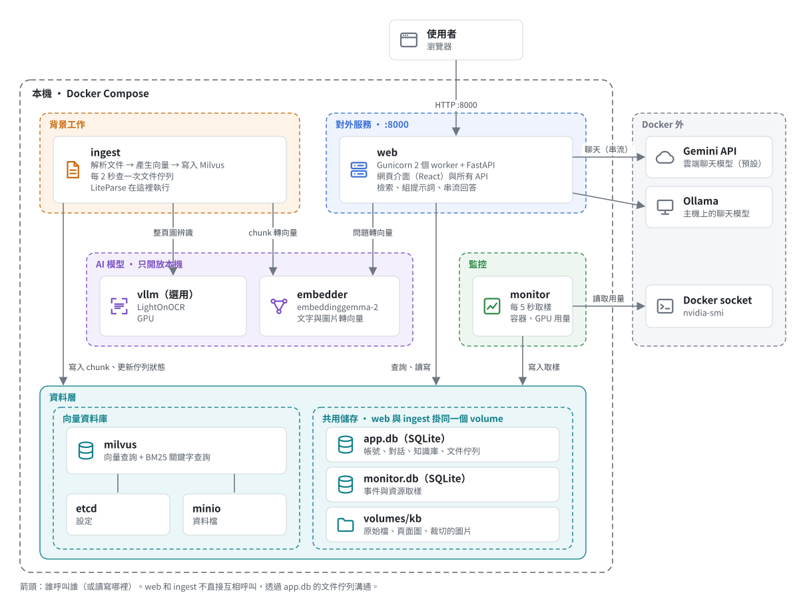
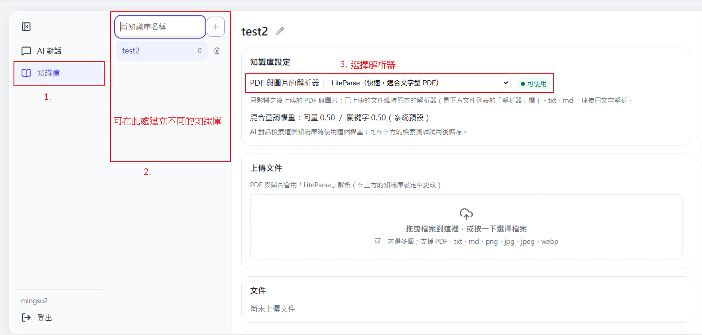

# Phoebe

## 專案簡介

Phoebe 是一個可以上傳 PDF、圖片和文字檔，再針對內容提問的 AI 知識庫問答系統。以 Docker 部署，支援多個帳號，每個帳號有獨立的對話和知識庫。



### 製作目的

- **解決 PDF 解析的難題**：PDF 裡常同時有純文字、內嵌圖片、掃描頁面和表格。希望能把這些內容都正確轉進知識庫，讓它們都能被查詢和引用。
- **改善只靠向量查詢的不足**：向量查詢擅長找意思相近的內容，但對專有名詞、編號、代碼這類需要字面完全相符的內容容易漏掉。所以結合關鍵字查詢，兩者互補。
- **熟悉 AI 應用的完整開發流程**：從文件解析、建立索引、檢索、組提示詞，到串流回答與部署。

### 特色

- **兩種文件解析器，可依知識庫選擇**：
  - LiteParse：用 CPU 就能跑，速度快。
  - LightOnOCR：在本機 GPU 上執行的小型視覺語言模型，擅長掃描檔、表格和複雜版面。
- **多模態 RAG**：
  - 整頁圖片和文字一起轉成向量（LiteParse），用文字提問也能找到圖表裡的內容。
  - 回答時把相關的頁面圖片或文件裡的圖片一起交給聊天模型看。
- **混合查詢**：BM25 關鍵字加上向量查詢，可以調整兩者的比例。
- **引用來源**：回答會標出資料來自哪份文件、哪一頁，並附上縮圖。
- **聊天模型可切換**：雲端 Gemini 或本機 Ollama，管理員在設定頁就能更換供應商和模型。
- **知識庫工具**：搜尋測試（可調整查詢比例）、查看每份文件的切段結果、失敗的文件可以重試。
- **依硬體彈性配置**：模型各自是獨立的服務，可以依照手上的硬體決定用 CPU 或 GPU (Embedding Model)，以及要開哪些服務。
- **資源監控與事件紀錄**：查看各容器和 GPU 的用量，以及每次文件處理、對話各階段花了多少時間。

多模態 RAG：用文字提問，也能找到圖片裡的內容並描述出來。



混合查詢：在搜尋測試調整向量與關鍵字的比例，直接看檢索結果。



### 使用的技術

| 用途 | 技術 |
|---|---|
| 後端 | FastAPI、Gunicorn、SQLite |
| 前端 | React、TypeScript、Vite |
| 向量資料庫 | Milvus（向量查詢，加上內建 BM25 與 jieba 中文斷詞） |
| 嵌入模型 | embeddinggemma-2（sentence-transformers、PyTorch） |
| 文件解析 | LiteParse（內建 pdfium、Tesseract OCR）、LightOnOCR（vLLM） |
| 聊天模型 | Gemini（google-genai）、Ollama |


### 重點設計

- **聊天和文件處理分成兩個服務**：web 負責網頁與對話，ingest 負責解析和建立索引。兩者透過 SQLite 裡的文件佇列溝通，處理大型文件時不會拖慢聊天。
- **嵌入模型獨立成一個服務**：Ollama 的嵌入 API 會忽略圖片，沒辦法產生圖文合一的向量，所以改用 sentence-transformers 直接執行模型。獨立出來之後，web 和 ingest 共用同一份模型。
- **整頁圖片和文字合成一個向量**：使用 LiteParse 時，每一頁的圖片和文字一起轉成一個向量。用文字提問時，可以命中只出現在圖片或圖表裡的內容。

### 架構



各服務的說明見 [docs/services.md](docs/services.md)，時序圖見 [docs/architecture.md](docs/architecture.md)。

## 快速開始（Docker）

### 前置需求

- Docker 與 Docker Compose 2.24 以上（Windows 用 Docker Desktop，WSL2 後端）
- 聊天模型（擇一）：Gemini API key，或在主機上執行的 Ollama
- 選用：NVIDIA GPU，只有使用 LightOnOCR 解析器時才需要

### 啟動

所有指令都在 `docker/` 目錄執行：

```
cd docker
cp .env.example .env
```

編輯 `docker/.env`，至少設定：

- `ADMIN_USERNAME`、`ADMIN_PASSWORD`：管理員帳號，啟動時自動建立。
- `GEMINI_API_KEY`：到 [Google AI Studio](https://aistudio.google.com/apikey) 建立後填入。改用本機 Ollama 的話可以留空，啟動後到「系統設定」切換。

然後啟動：

```
docker compose up -d --build
```

開啟 http://localhost:8000，用管理員帳號登入。

- 第一次啟動會下載嵌入模型（約 1.5 GB），等 `docker compose ps` 顯示 embedder 為 healthy 後才能使用知識庫。
- 要使用 LightOnOCR，啟動和停止都加上 `--profile lightonocr`：
  ```
  docker compose --profile lightonocr up -d --build
  docker compose --profile lightonocr down
  ```
- 停止：`docker compose down`（資料會保留）。`down -v` 會連資料一起刪除，不要隨意使用。

GPU 設定、主機 Ollama 連線、備份、從舊版升級、反向代理等，見 [docker/README.md](docker/README.md)。

## 使用方式

### 知識庫

側邊欄「知識庫」可建立知識庫、上傳文件；AI 對話上方的下拉選單可為每個對話選用一個知識庫。回答下方會列出引用卡片：每張卡片顯示檔名、頁碼、相關度分數與內容預覽（預設收合、只顯示約 120 字，可展開），有圖片的來源會附縮圖，點擊可放大。



支援的檔案類型：`.pdf`、`.txt`、`.md`、`.png`、`.jpg`、`.jpeg`、`.webp`。

- **PDF**：每頁一個 chunk（整頁文字，加上該頁的圖片資訊）。
- **txt／md**：txt 依段落合併、md 依標題分段，每個 chunk 至多 1500 字（需為 UTF-8，含 BOM 也可）；不需選解析器。
- **圖檔**：一張圖一個 chunk，視為單頁，依知識庫的解析器處理。

PDF 與圖檔的解析器是**知識庫層級的設定**（知識庫頁上方的「知識庫設定」，新建的知識庫預設 LiteParse），之後上傳的 PDF 與圖檔一律使用這個設定；txt、md 一律用文字解析，不受影響。

> **注意：改了解析器只影響之後上傳的檔案。** 已經上傳的文件會維持原本的解析器，不會自動重新處理，所以同一個知識庫裡可能同時有用不同解析器處理的文件（文件列表的「解析器」欄會顯示每份文件實際用的解析器）。想讓舊文件也改用新解析器，請刪除後重新上傳。
>
> 從沒有這個設定的舊版升級時，每個知識庫會依現有文件補上設定：PDF 與圖檔都用同一個解析器的，就沿用那個解析器；沒有這類文件或混用的，設為 LiteParse。

解析器的差異如下。每個解析器怎麼切 chunk、送什麼給 embedding 模型、回答時附哪些圖，詳見 [docs/parsers.md](docs/parsers.md)；實測的處理時間見 [docs/parser-benchmarks.md](docs/parser-benchmarks.md)。

| 解析器 | 適合 | 說明 |
| --- | --- | --- |
| LiteParse | 文字型 PDF | 預設、速度快、不需 GPU；掃描頁會用內建 Tesseract（`chi_tra+eng`）辨識，但中文品質有限。每頁另存一張頁面圖（400 DPI 渲染後縮到最長邊 1536 px，`page_{n}.png`），向量由「整頁圖＋該頁文字」產生（**頁面圖向量**），圖表、照片與版面也能被檢索到 |
| LightOnOCR-3-0.8B | 掃描檔、表格、複雜版面 | 在本機 GPU 執行，輸出 Markdown 與各區塊座標（grounding）；RTX 2060 上每頁約 24 秒（一次送 4 頁）。依座標把頁面中的圖片**裁切**成獨立的圖（`img_{頁}_{序}.png`，捨棄頁首、頁尾與頁碼）；向量**只由**頁面的 Markdown 文字產生（裁切圖本身不轉成向量，只靠模型寫的圖片描述被檢索到），裁切圖附在該頁的引用卡片上，也會一併附給聊天模型 |

兩者差別：LiteParse 以「整頁圖」進入向量（圖片內容本身可被文字問題檢索到），LightOnOCR 以「文字」進入向量、另存「裁切出的單張圖」供引用與附圖（能精準顯示單張圖表）。圖檔（png、jpg、jpeg、webp）可選擇任一解析器，視為單頁。

文件在背景依序處理（排隊中 → 解析中 → 建立索引中 → 完成／失敗）；伺服器重啟後，未完成的文件會自動重新處理。

### 回答時附圖

回答時會把檢索到的參考圖片一併附給聊天模型（依參考資料順序，頁面圖優先，最多 `KB_MAX_IMAGES` 張，預設 4；最長邊超過 1536 px 會先縮小）。模型不支援圖片時，系統會自動不帶圖重試一次，使用者不會看到錯誤。

注意（Ollama 視覺模型）：4 張大圖可能超過預設的 context 長度（`num_ctx`）。若回答被截斷或失敗，請調低 `KB_MAX_IMAGES`（`0` 為不附圖），或調高 `OLLAMA_NUM_CTX`（預設 16384）。程式每次請求都會帶上這個值，所以 Modelfile 的 `PARAMETER num_ctx` 和 Ollama 的 `OLLAMA_CONTEXT_LENGTH` 都不會生效。

### 管理員與帳號

- **管理員**：由 `docker/.env` 的 `ADMIN_USERNAME`、`ADMIN_PASSWORD` 建立。改了密碼後執行 `docker compose up -d` 就會生效，該帳號原本的登入會被登出。若已有人註冊了同名帳號，密碼會被改成 `.env` 的值並成為管理員。
- **其他使用者**：預設不開放註冊。要讓別人自己註冊，在 `docker/.env` 設 `ALLOW_REGISTRATION=true` 再執行 `docker compose up -d`；帳號建好後可以改回 `false`。
- **系統設定頁**（只有管理員看得到）：所有使用者的聊天都套用這份設定。
  - LLM 供應商：Gemini 或本機 Ollama（未設定 `GEMINI_API_KEY` 時 Gemini 選項停用）
  - 模型：從目前的供應商即時取得清單後選擇
  - 系統提示詞（最多 4000 字）與 temperature
- **監控頁**（只有管理員看得到）：事件紀錄（文件處理、AI 對話、搜尋測試各階段的耗時）、各容器與 GPU 的用量，以及隨時間變化的圖表。說明見 [docs/monitoring.md](docs/monitoring.md)。

GPU 用在 OCR（vLLM）時，建議聊天改用 Gemini，避免和 OCR 搶顯存。

## 設定

設定放在 `docker/.env`，改完執行 `docker compose up -d` 才會套用（`restart` 不會重新讀取）。最常改的幾個：

| 變數 | 預設值 | 說明 |
| --- | --- | --- |
| `ADMIN_USERNAME`、`ADMIN_PASSWORD` | 空 | 管理員帳號與密碼 |
| `GEMINI_API_KEY` | 空 | Gemini 金鑰；只放在 `docker/.env`，不會出現在介面或資料庫 |
| `LLM_PROVIDER` | `gemini` | 預設的聊天供應商，之後以「系統設定」頁為準 |
| `ALLOW_REGISTRATION` | `false` | 是否開放任何人註冊 |
| `PHOEBE_PORT` | `8000` | 對外連接埠；設成 `127.0.0.1:8000` 就只有本機能連 |
| `KB_VECTOR_WEIGHT` | `0.5` | 混合查詢中向量的預設權重，每個知識庫可以另外設定 |
| `KB_MAX_IMAGES` | `4` | 回答時附給模型的圖片上限 |
| `MAX_UPLOAD_MB` | `50` | 單一上傳檔案上限 |

完整的環境變數列表見 [docs/configuration.md](docs/configuration.md)。

## 文件

- [docs/services.md](docs/services.md)：每個服務的工作、資料流程、資料存放位置、並行數與批次大小
- [docs/architecture.md](docs/architecture.md)：架構圖與時序圖
- [docs/parsers.md](docs/parsers.md)：兩種解析器怎麼切段、送什麼給嵌入模型
- [docker/README.md](docker/README.md)：Docker 部署的細節
- [docs/configuration.md](docs/configuration.md)：所有環境變數
- [docs/development.md](docs/development.md)：本機開發、測試、效能測試與開發流程

## 專案結構

- `app/` — 後端（設定、資料庫、驗證、對話、路由）
- `app/llm/` — 聊天模型的客戶端（Ollama、Gemini）
- `app/kb/` — 知識庫（資料存取、解析器、索引、背景處理）
- `app/monitor/` — 監控（任務事件、資源取樣、monitor 服務）
- `embedder/` — Embedding 服務（獨立的套件環境與測試）
- `docker/` — Docker 部署（compose、Dockerfile、說明）
- `scripts/` — 手動執行的腳本（效能測試、對話壓力測試、資源紀錄、OCR 驗證、畫架構圖）
- `docs/` — 說明文件
- `frontend/` — 前端（React + TypeScript + Vite）
- `tests/` — 單元測試
