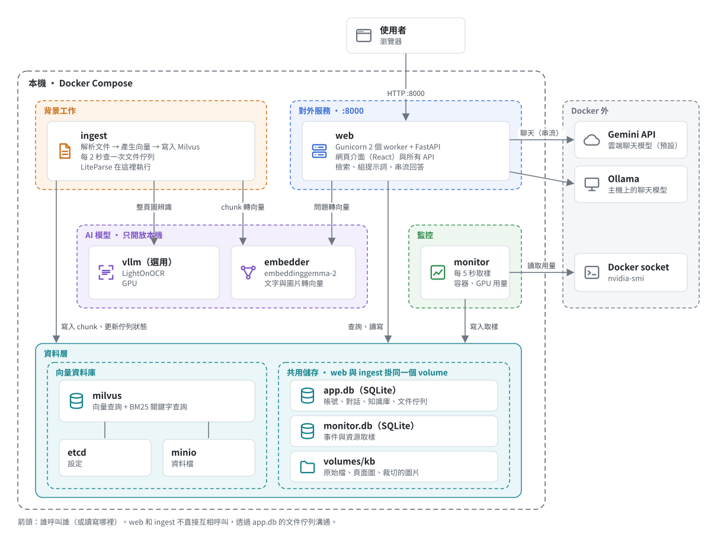
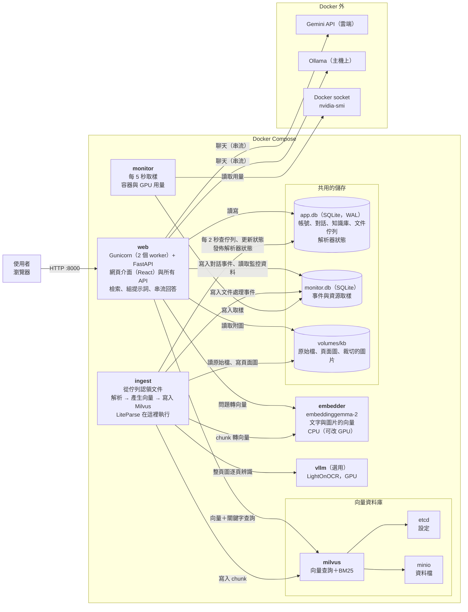
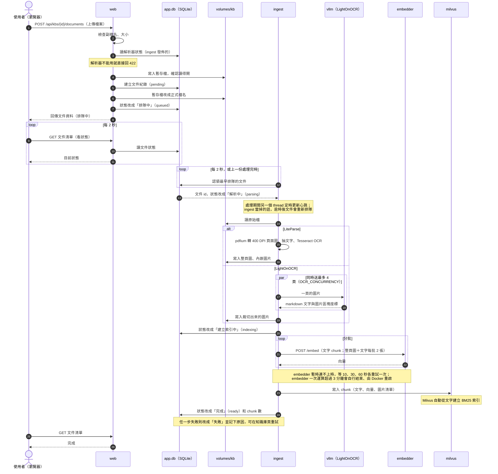
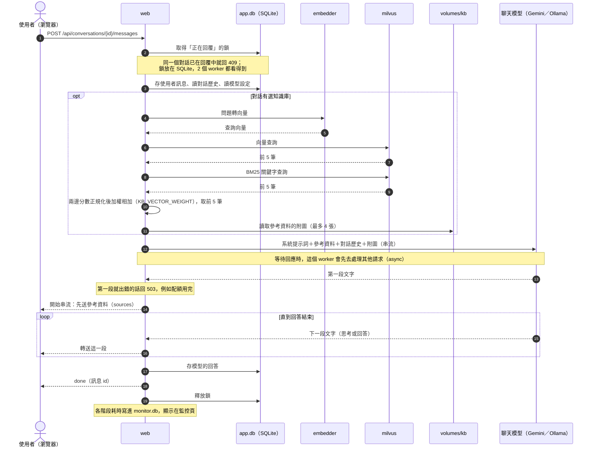

# 系統架構圖與時序圖

用 Docker Compose 部署時的完整架構，以及「上傳文件到知識庫」和「對話」兩個流程的時序圖。各服務的詳細說明見 [services.md](services.md)，設定見 [docker/README.md](../docker/README.md)。

分層架構圖是 SVG（[images/architecture.svg](images/architecture.svg)，用 `uv run python -m scripts.draw_architecture` 產生，要改圖就改這支腳本再重跑）。其餘的圖用 Mermaid 寫成。兩種圖 GitHub 和 VS Code 的 Markdown 預覽都能直接顯示。

## 架構圖

### 連線細節

每條連線讀寫什麼：

重點：

- **web 和 ingest 不直接互相呼叫**。web 把文件放進 SQLite 的佇列（狀態「排隊中」），ingest 每 2 秒去查一次。解析器能不能用，也是 ingest 寫進 SQLite、web 去讀。
- **只有 web 對外**（`:8000`）。embedder、vllm、milvus 只綁在本機 `127.0.0.1`，其他服務完全不對外。
- **兩個 SQLite 檔和 `volumes/kb` 由 web、ingest 共用**。web 與 ingest 掛載同一個 volume；monitor 只用 `monitor.db`。
- **聊天模型在 Docker 外**：預設用 Gemini，也可以在「系統設定」頁改用主機上的 Ollama。
- **vllm 是選用的**：只有加上 `--profile lightonocr` 時才啟動，用 LightOnOCR 解析時才需要。

## 時序圖：上傳文件到知識庫

以一份 PDF 為例。txt／md 不經過解析器，直接切段。

## 時序圖：對話

以「選了知識庫的對話」為例。沒選知識庫時，跳過檢索那一段。

